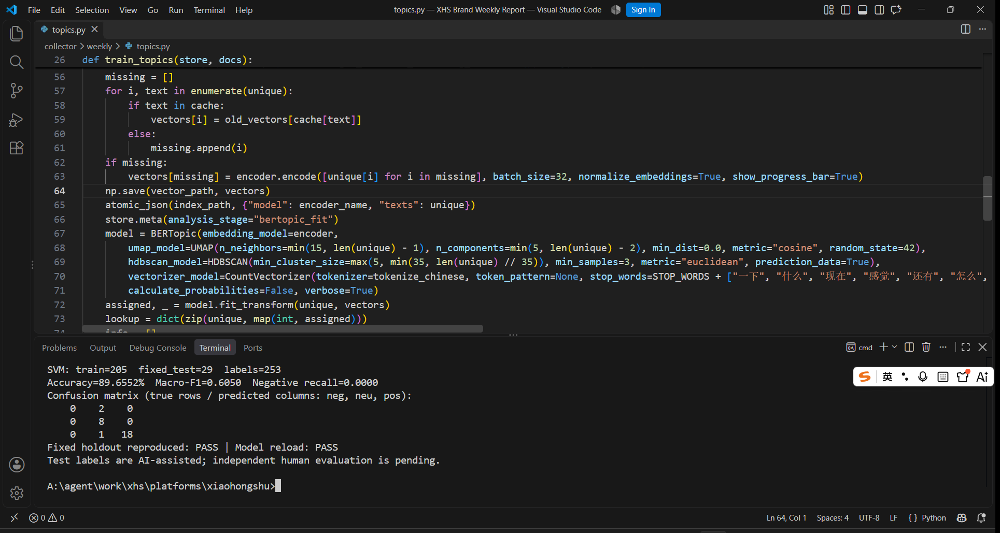
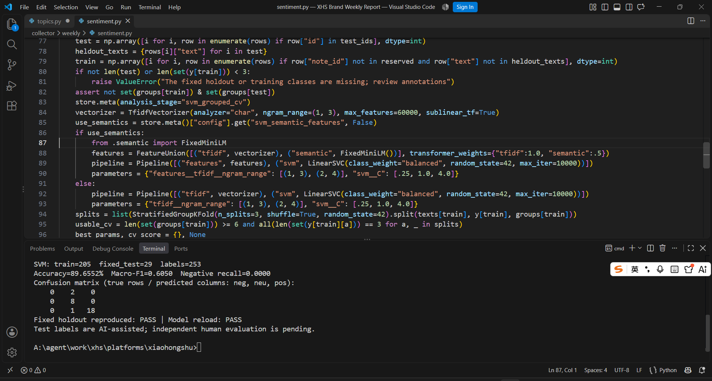
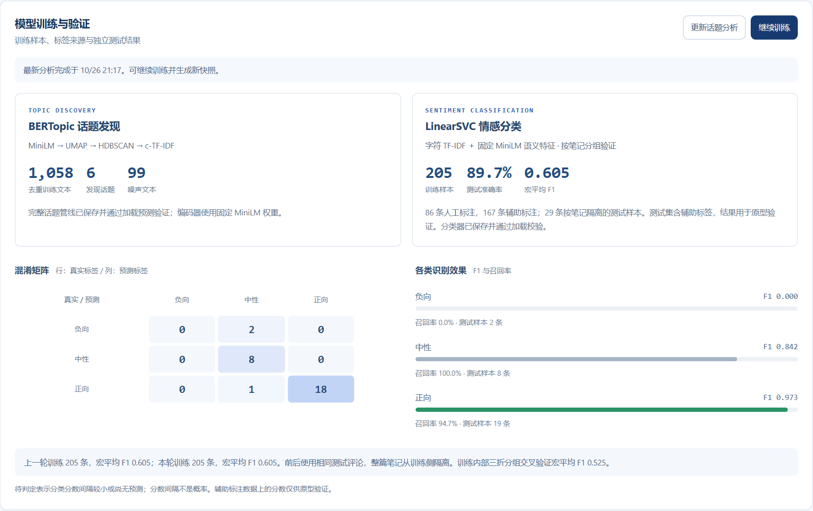

# 小红书品牌周报系统的智能算法与实现

课程材料：[智能算法原理与实现 Word](李昊阅_202409010201_智能算法原理与实现.docx)。沿用课程模板的页面尺寸、正文与页眉页脚，包含具体算法原理、处理数据、实测效果和开发环境截图。

## 具体算法及其作用

**BERTopic** 用于聚合品牌相关笔记标题、正文和评论。固定编码器为 `sentence-transformers/paraphrase-multilingual-MiniLM-L12-v2`，生成 384 维归一化向量；UMAP 将其降至 5 维，HDBSCAN 识别密度簇与噪声，c-TF-IDF 提取每簇关键词。当前拟合参数包括 `n_neighbors=15`、`min_dist=0`、`min_cluster_size=30`、`min_samples=3`。话题数量由数据拟合得到。

**LinearSVC** 用于真实评论的正向、中性、负向分类。字符 TF-IDF 与固定 MiniLM 语义向量拼接，语义分量权重为 0.5；分类器采用一对其余策略、L2 正则化和平方铰链损失。训练内部三折分组交叉验证选中字符 2 至 4 gram、`C=1.0`，并设置 `class_weight="balanced"`。最高与次高分类分数差小于 0.2 时转为待复核，该分差不是概率。

## 真实数据与评测

模型记录生成于 **2026 年 10 月 26 日 21:17（北京时间）**，并于 21:24 实际加载模型复现结果。

| 项目 | 本次结果 |
| --- | --- |
| BERTopic 输入文本 | 1,737 条品牌相关标题正文及评论 |
| 有效去重文本 | 1,058 条 |
| 话题与噪声 | 6 个话题、99 条噪声 |
| SVM 有效标签 | 253 条，人工 86 条、AI 辅助 167 条 |
| 评估训练与固定测试 | 205 条训练、29 条测试；另有 19 条来自整篇保留笔记 |
| 测试准确率 | 89.66%，26/29 正确 |
| 测试宏平均 F1 | 0.6050 |
| 负向召回率 | 0.00%，2 条负向均预测为中性 |
| 中性与正向召回率 | 100.00%、94.74% |
| 模型加载与结果复现 | BERTopic 和 SVM 均通过 |

固定测试评论所属整篇笔记与训练部分隔离，参数选择仅使用训练内部交叉验证；评估分类器与在全部标签上重拟合的生产分类器分别保存。测试集全部为辅助标签，独立人工评估仍待补充。BERTopic 尚无人工话题真值集，6 个话题中的大簇包含泛互动讨论，话题数量不等于有效营销热点数。

复核时任务已有 3,850 篇搜索去重笔记、7,800 条评论，仅 301 篇达到当前采集目标，采集仍为部分完成。评论采用前两页主评论和随页回复口径，保留此前较深覆盖的数据；模型样本量与采集总数分别统计。系统实现了自动话题聚合、情感初筛和证据下钻；当前未测量实际节省工时或营销收益。

## 真实开发与运行截图

截图来自本机 VS Code 和真实的本地周报页面，终端输出由保存模型实际复算获得。







## 本地复现

在 `platforms/xiaohongshu` 目录运行以下命令，`REPORT_ID` 为本地已有任务 ID。此操作只加载本地数据和模型，复算固定测试集与混淆矩阵，验证保存模型哈希及 BERTopic 加载预测，不启动采集或训练。

```powershell
.\.venv-weekly\Scripts\python.exe scripts\verify_weekly_models.py --job REPORT_ID
```

实现位置：`collector/weekly/topics.py`、`sentiment.py`、`semantic.py`；复核入口：`scripts/verify_weekly_models.py`。已发布材料只包含说明、截图和汇总指标；账号状态、原始评论和模型产物保留在本地运行目录。
