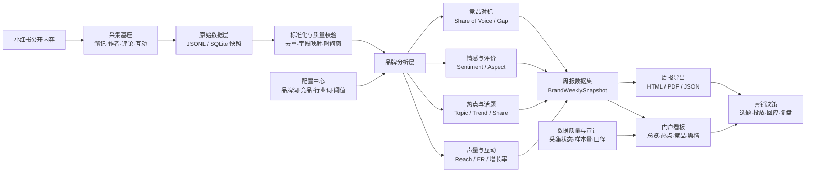

# 小红书品牌营销可视化周报系统

## 1. 建设定位

小红书采集工作台负责把公开笔记、作者、互动和评论带回本地；品牌周报系统在此基础上完成统一口径、指标计算、洞察生成和周报发布。两者通过离线可重放的数据契约连接，采集任务失败或会话过期时，分析层仍保留上一版快照和数据质量说明。

系统服务品牌市场、内容运营和公关团队，核心输出是一份可追溯的周报：本周发生了什么、哪些内容带来增长、竞品在哪些话题上领先、用户为什么喜欢或不满，以及下周应该优先做什么。

## 2. 一张图：从采集到决策



### 分层职责

| 层 | 责任 | 产物 |
| --- | --- | --- |
| 采集基座 | 复用现有小红书搜索、详情、作者、评论和后台任务能力 | 原始响应、请求轨迹、采集任务状态 |
| 原始数据层 | 按周保存可重放快照，不覆盖历史 | `output/` 下的 JSONL/SQLite 快照（暂时） |
| 标准化层 | 统一品牌、竞品、话题、互动字段；记录缺失原因 | `NormalizedNote`、`NormalizedComment` |
| 分析层 | 计算声量、互动、情感、话题、竞品差距和风险分 | `BrandWeeklySnapshot` |
| 展示层 | 以周为单位呈现趋势、结论、证据和数据质量 | 门户看板、HTML/PDF/JSON 周报 |

## 3. 指标与数据口径

- **品牌声量**：时间窗内命中品牌词或品牌别名的去重笔记数。默认按笔记 ID 去重，品牌词命中规则可在配置中心调整。
- **互动量**：点赞、收藏、评论、分享的加总；互动率为互动量 / 曝光代理值，当前没有曝光字段时显示为“互动/笔记”，不伪造曝光。
- **情感倾向**：对正文和主评论分别打分，再按文本长度和互动权重汇总；低置信文本进入“待复核”，不直接计入风险结论。
- **热点话题**：按话题词的声量、环比增长和互动效率排序；增长率需要上一完整周样本，样本不足时标记为“基线不足”。
- **竞品份额**：品牌词组之间使用相同时间窗、相同去重规则计算 Share of Voice，并展示样本量和采集覆盖率。
- **风险话题**：负向占比、增长速度和高互动负向内容共同决定风险分；风险卡片必须能下钻到笔记和评论证据。

## 4. 门户信息架构

1. **总览**：周选择器、四张核心 KPI 卡、声量/互动趋势、本周结论、热点摘要。
2. **热点雷达**：话题排行、增长曲线、内容样本、可复制的选题建议。
3. **竞品对标**：Share of Voice、互动效率、内容类型和达人结构对比。
4. **情绪与评价**：正负向趋势、评价维度、原声评论和风险告警。
5. **周报归档**：按品牌和周次保存快照，支持导出和复盘。
6. **配置中心**：品牌词、竞品词、行业词、情绪阈值、采集范围和数据保留周期。

## 5. 关键对象

```text
Brand
  id, name, aliases[], category, color

WeeklySnapshot
  brand_id, week_start, week_end, sample_size, coverage, generated_at
  kpis{volume, interactions, positive_rate, risk_topics}
  trend[], topics[], competitors[], sentiment[], insights[]

Evidence
  note_id, author_id, title, url, matched_terms[], sentiment, metrics, captured_at
```

每个结论都必须带 `evidence` 引用；前端展示的“增长”“风险”“领先”不能脱离样本量、时间窗和采集覆盖率。

## 6. 开发拆分

### 本次交付

- `platforms/xiaohongshu/web/brand-report/`：门户静态页面、响应式样式和演示数据交互。
- 门户从 `/brand-report/` 访问，保留原采集工作台 `/` 不变。
- 页面提供“演示数据”标识、周切换、刷新运行状态、导出 JSON 和模块锚点导航，后续可将 `app.js` 的数据适配器替换为真实接口。

### 下一阶段

1. 在 `collector/service.py` 增加标准化快照写入和周报聚合任务。
2. 增加离线 fixture 与 `BrandWeeklySnapshot` schema 校验。
3. 接入本地情感/主题模型，将低置信结果置入人工复核队列。
4. 用 Playwright 或浏览器导出 HTML/PDF，保留数据血缘和生成时间。
5. 增加定时任务、异常阈值通知和历史周报对比。

## 7. 验收标准

- 采集失败、字段缺失和样本不足在门户中可见，不被渲染成 0。
- 任何 KPI 可以追溯到时间窗、样本量、口径和至少一条证据。
- 页面在 375px 宽度下可滚动使用，桌面端不出现横向滚动条。
- 离线 fixture 可重复生成同一份周报；测试不会触发真实采集或消息发送。
